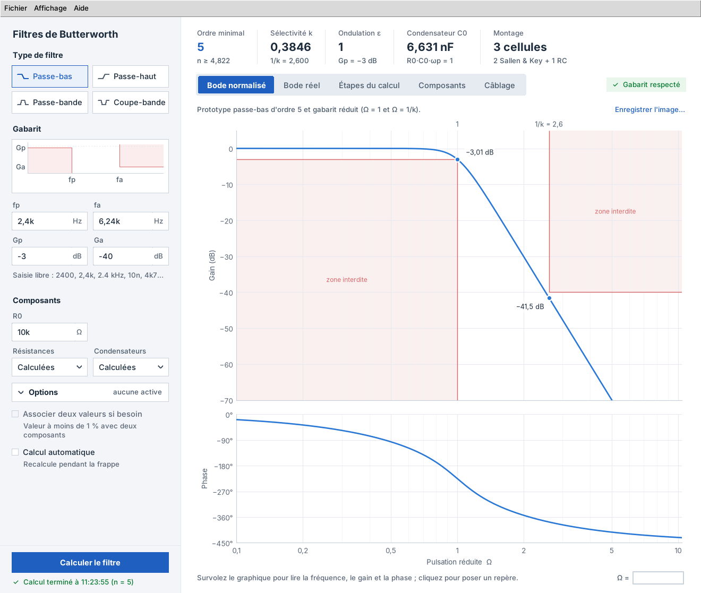
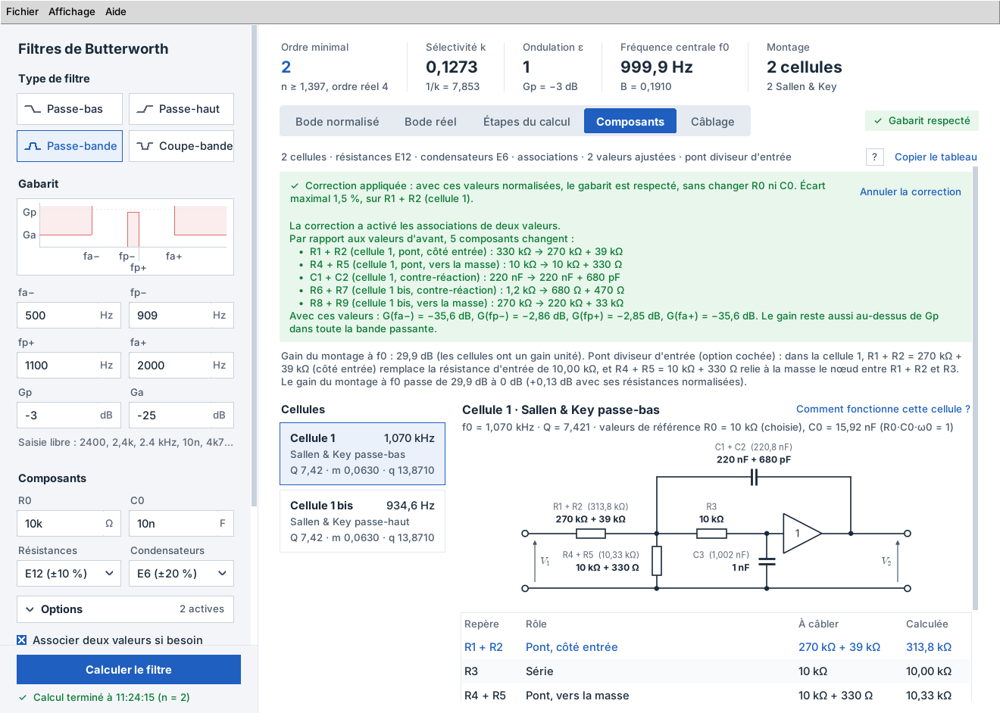
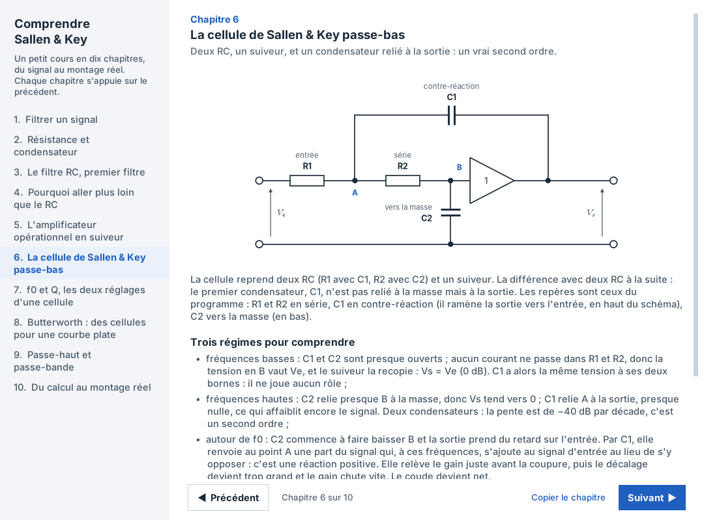

# Filtres de Butterworth

Synthèse de filtres de Butterworth réalisés avec des cellules de Sallen & Key à gain unité :
du gabarit au schéma de câblage, avec les calculs rédigés comme une copie.

*English summary: a free Windows desktop application (Python/Tkinter) that designs analog
Butterworth filters built with unity-gain Sallen-Key cells, from a frequency template to the
wiring diagram: step-by-step calculations, component values (exact or E6/E12/E24 series),
SPICE netlists for LTspice and PSpice, a PDF report and a beginner course. The user interface
is in French. MIT license.*



## Télécharger

L'installateur Windows se trouve dans les
[Releases](https://github.com/nouxel00/filtres-butterworth/releases/latest) :
`Installer_FiltresButterworth_2.1.exe`. Il ne demande aucun droit administrateur. Le mode
d'emploi est dans le programme (menu Aide, F1) et dans `LISEZMOI.txt`.

Les versions suivantes s'installent ensuite depuis le programme, avec l'accord de
l'utilisateur : il vérifie au démarrage si une nouvelle version est publiée ici et l'installe
d'un clic (menu Aide > Rechercher une mise à jour).

Tant que le programme n'est pas signé, Windows peut afficher « Windows a protégé votre
ordinateur » : cliquer sur « Informations complémentaires », puis sur « Exécuter quand même ».

## Ce que fait le logiciel

À partir d'un gabarit (passe-bas, passe-haut, passe-bande ou coupe-bande) :

- l'ordre minimal, la fonction de transfert normalisée et la fonction de transfert réelle,
  avec les six étapes du calcul rédigées comme une copie ;
- les diagrammes de Bode normalisé et réel, avec le gabarit ;
- les résistances et condensateurs de chaque cellule, en valeurs calculées ou normalisées
  (E6, E12, E24), corrigées en un clic quand le gabarit n'est plus respecté, sans changer
  R0 ni C0 ;
- le schéma de câblage avec des µA741, la nomenclature et les netlists pour LTspice et
  PSpice (version étudiante comprise) ;
- un compte rendu PDF ;
- un petit cours pour débutant, « Comprendre Sallen & Key », en dix chapitres.





## Lancer depuis Python

Avec Python 3.10 ou plus récent :

```
pip install numpy matplotlib pillow
python main.py
```

`python moteur.py` lance seulement les calculs sur deux exemples de vérification.

## Construire le programme et l'installateur

- **Sur un PC Windows** : double-cliquer sur `construire_windows.bat`, dans le dossier
  décompressé (Python 3.12 à 3.15 et [Inno Setup 7 ou 6](https://jrsoftware.org/isdl.php) ;
  s'ils manquent, le fichier propose de les installer avec winget). Résultat dans `dist\`,
  qui s'ouvre à la fin.
- **Automatiquement** : le workflow GitHub Actions [Windows](.github/workflows/windows.yml)
  construit le programme (PyInstaller) et l'installateur (Inno Setup) à chaque envoi sur
  `main`, sur les machines de GitHub. Quand une Release est publiée (étiquette `vX.Y`),
  il y joint l'installateur.

Détails dans `LISEZMOI.txt`, partie 3.

## Politique de signature du code (code signing policy)

Les fichiers Windows publiés dans les Releases, le programme `FiltresButterworth.exe` et
l'installateur, seront signés gratuitement par [SignPath.io](https://signpath.io), avec un
certificat de la [SignPath Foundation](https://signpath.org) : la demande est en cours.
D'ici là, ils ne sont pas signés.

- Seuls les fichiers construits par le workflow GitHub Actions de ce dépôt, à partir de son
  code source, sont soumis à la signature. Aucun fichier construit ailleurs n'est signé.
- Chaque demande de signature est approuvée à la main par l'approbateur.
- Les bibliothèques fournies avec le programme (Python, numpy, matplotlib, Pillow, Tcl/Tk)
  ne sont pas signées par ce projet.

| Rôle | Membres |
| --- | --- |
| Auteur et relecteur (committer, reviewer) | [Axel Sanou](https://github.com/nouxel00) |
| Approbateur des signatures (approver) | [Axel Sanou](https://github.com/nouxel00) |

## Confidentialité (privacy policy)

Ce programme ne transmet aucune information à d'autres systèmes en réseau, sauf à la
demande expresse de son utilisateur. *This program will not transfer any information to
other networked systems unless specifically requested by the user or the person installing
or operating it.*

Il n'utilise Internet que pour les mises à jour, et seulement si l'utilisateur l'a accepté
(question posée au premier lancement, modifiable dans le menu Aide) ou le demande (Aide >
Rechercher une mise à jour). Il demande alors à GitHub le numéro de la dernière version
publiée dans ce dépôt ; si l'utilisateur clique sur « Installer », il télécharge
l'installateur depuis les Releases de ce dépôt. Aucun identifiant ni aucune donnée de
l'utilisateur n'est envoyé : ni télémétrie, ni statistiques. Comme pour toute page web,
GitHub voit l'adresse IP de l'ordinateur (voir la
[politique de confidentialité de GitHub](https://docs.github.com/site-policy/privacy-policies/github-general-privacy-statement)).

Il enregistre seulement, sur l'ordinateur :

- les préférences et la dernière saisie, dans `%APPDATA%\FiltresButterworth` ;
- la liste des polices préparée pour les graphiques, dans
  `%LOCALAPPDATA%\FiltresButterworth\matplotlib` (effacée à la désinstallation) ;
- les fichiers que l'utilisateur enregistre lui-même (filtres, PDF, images, netlists) ;
- pendant une mise à jour, l'installateur téléchargé dans `%TEMP%\FiltresButterworth`
  (effacé au lancement suivant) et le journal de l'installation,
  `%TEMP%\FiltresButterworth_mise_a_jour.log` ;
- en cas d'erreur, un journal dans `%TEMP%\FiltresButterworth.log`.

## Licence

[MIT](LICENSE). Le programme installé contient aussi Python, numpy, matplotlib, Pillow et
Tcl/Tk, chacun sous sa propre licence libre.
